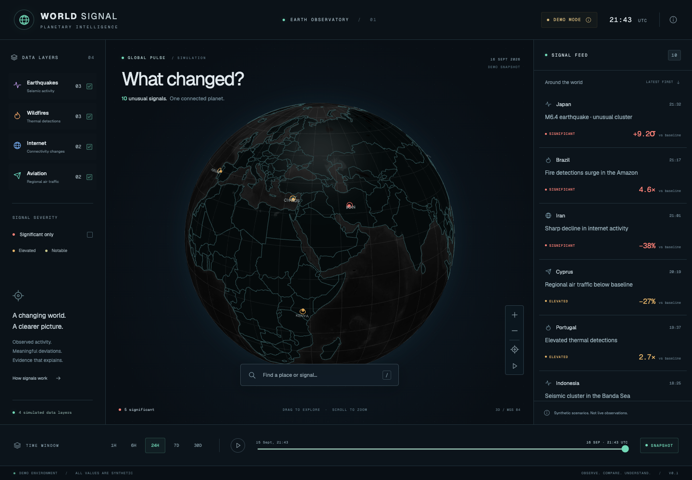

# WORLD SIGNAL

**What changed?** A globe-first observatory for unusual activity across independent real-world systems.

This release delivers **Phase 1: the interactive visual prototype**. All 14 scenarios and their 30-day reference samples are deterministic, synthetic and visibly labeled. **No real-time data provider is connected.** Source links are provider references, not corroboration of simulated events.



## Run locally

Node.js 20.9+ and npm are required.

```sh
npm ci
npm run dev
```

Open http://localhost:3000. No API keys, accounts, database or external runtime map requests are required. Fonts are downloaded during the first Next.js build and then served locally. Globe geometry and texture are bundled in `public/geo`.

```sh
npm run lint
npm run typecheck
npm test
npm run build
npx playwright install chromium
npm run test:e2e
```

Browser tests start a production server on port 3012 and exercise desktop, tablet and mobile layouts. Test screenshots and traces are in the ignored `test-results/` directory.

## Included

- Lazy-loaded WebGL globe: drag, zoom, reset, optional rotation, animated severity markers, country selection and smooth signal focus.
- Four independent layer toggles, severity filter, chronological feed and empty states.
- Signal detail: observed value, reference mean, calculated deviation, chart, methodology, limitations, timestamp and provider reference.
- 1h / 6h / 24h / 7d / 30d windows and a replay scrubber anchored to **2026-09-16 21:43 UTC**. This is a demo timeline, not a historical archive.
- Place / type / event substring search over the demo dataset. Press `/` to search, Enter to focus the first result and Escape to close details.
- Country dimensions show demo coverage independently. Missing data is never labeled normal.
- Responsive layouts, keyboard-operable feed and controls, reduced-motion handling and a feed fallback if WebGL cannot initialize.
- Pure baseline and classification functions, typed provider contract, server-rendered snapshot and `GET /api/signals`.

## Trust model

`provenance` belongs to each signal; `mode` belongs to the snapshot. A future provider failure must expose an unavailable/stale status, never silently substitute synthetic data into a live response. Demo confidence is low for real-world conclusions. Context is editorial, not LLM output. The chart distinguishes reference samples from the current observation; its dashed connector is not measured history.

Synthetic scenarios do not establish an actual incident, impact or cause. Sample baselines do not model seasonality, satellite coverage, telemetry completeness or reporting delays.

## Structure

```
src/app/                    Next.js shell and snapshot API
src/components/             Globe, dashboard, evidence chart, signal details
src/core/types.ts           Normalized signals and provider contract
src/core/analysis.ts        Baselines, configurable thresholds, filtering
src/providers/demo.ts       Deterministic and labeled demo snapshot
public/geo/                 Self-hosted map assets
tests/                     Statistical invariants and browser journeys
docs/architecture.md       Decisions, limitations and next phases
```

## Next phases

1. USGS and NASA FIRMS adapters with provenance, validation, caching and explicit failure states.
2. PostgreSQL observations and ingestion runs; historical aggregation, coverage checks and provider-specific baselines.
3. Internet and aggregated aviation providers, subject to available credentials and usage terms.
4. Evidence-constrained AI briefs, query interpretation and cross-layer correlation. Correlation must not imply causation.

See [architecture](docs/architecture.md) and [asset credits](docs/credits.md).

On older macOS versions unsupported by the bundled browser, set `PLAYWRIGHT_CHROMIUM_EXECUTABLE_PATH` to an existing compatible Chromium executable when running browser tests.
