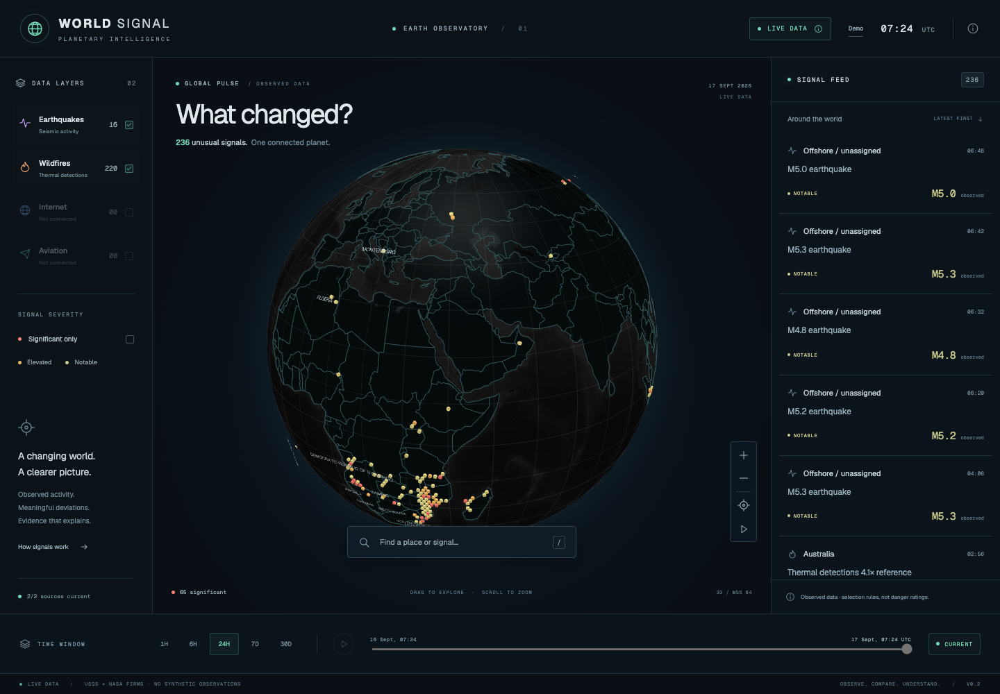

# WORLD SIGNAL

**What changed?** A globe-first observatory for unusual activity across independent real-world systems.

Phase 2 connects **USGS earthquakes and NASA FIRMS fire detections** to PostgreSQL, deterministic anomaly analysis and the existing interactive globe. Live observations and the explicitly labeled synthetic demo remain separate. No AI-generated analysis is used.



## Run locally

Node.js 20.9+ and npm are required.

```sh
npm ci
npm run db:local
```

Keep that terminal open. This initializes a real, isolated PostgreSQL cluster on loopback port 55432, creates the development/test databases and writes local credentials to ignored `.env.local`. The database persists under ignored `.data/`; stop it with Ctrl+C. The helper uses platform-specific PostgreSQL binaries and is intended for development.

In a second terminal:

```sh
npm run db:migrate
npm run db:seed
npm run ingest:all -- --history
npm run dev
```

Open http://localhost:3000/?mode=live. Initial ingestion downloads the USGS monthly feed and NASA's seven-day NOAA-20 feed; allow several minutes and sufficient disk space for hundreds of thousands of observations. `db:seed` registers providers only; it never inserts simulated observations.

In a third terminal, keep the scheduler running:

```sh
npm run worker
```

USGS is collected every five minutes, FIRMS every hour, history refreshed daily, and signals recomputed every five minutes. The page polls the stored API every minute; **CURRENT** requests a refresh.

For an existing PostgreSQL service, copy `.env.example` to `.env.local`, set `DATABASE_URL` and `WORLD_SIGNAL_MODE=live`, then migrate, seed, ingest and run the worker. Do not commit credentials. Production requires persistent PostgreSQL and a separate long-running worker; the Next.js web process does not perform ingestion on page requests.

The hosted setup uses Aiven PostgreSQL with compact historical storage and an hourly GitHub Actions collector. See [hosted operation and retention](docs/hosted-operations.md).

For Vercel, follow the [production database and worker setup](docs/vercel-deployment.md). A web deployment does not create the database or start collection. Run `npm run db:check` to diagnose the configured database without printing credentials.

## Sources and limits

- [USGS GeoJSON feeds](https://earthquake.usgs.gov/earthquakes/feed/v1.0/geojson.php): individual events selected by configurable magnitude/significance/depth rules, plus regional count anomalies when adequate coverage exists.
- [NASA FIRMS active-fire downloads](https://firms.modaps.eosdis.nasa.gov/active_fire/): public NOAA-20 VIIRS CSV, without a key. Detections are aggregated into H3 geographic cells and compared with covered historical windows. A detection is not a confirmed incident or burned-area estimate.
- Public FIRMS history starts with seven days, currently yielding five to six usable reference windows. The UI reports the actual reference count and marks short histories **provisional**. A 30-day reference becomes available as ingestion accumulates coverage; missing days are never invented.
- Optional authenticated backfill: set `FIRMS_TRANSPORT=api` and `NASA_FIRMS_API_KEY`, then run `npm run backfill:firms`. This requests 31 days in bounded batches, subject to NASA availability and account limits. The authenticated upstream path has not been exercised with a real key in this release.
- Confidence describes data quality and reference support, not the probability of an incident. Internet and aviation remain disabled in live mode. Live historical filters query persisted signals; continuous historical replay remains demo-only.

Provider outages expose unavailable, partial or delayed states. Last collected/observed times and errors are available in the status dialog and API. A live failure never substitutes demo data.

## API

- `GET /api/signals?mode=live&type=earthquake,wildfire&limit=250`
- `GET /api/signals/:id?mode=live`
- `GET /api/providers/status`

Signal filters: `type`, exact `severity` (`notable`, `elevated`, `significant`), ISO `since`/`until` (maximum 31-day interval), `bbox=west,south,east,north` (antimeridian supported), `q`, exact `country`, `includeResolved=true`, `limit` (1–500), and `offset`. Responses include mode, freshness, provider health, total and truncation information. Invalid filters return 400, unknown details 404, and unavailable storage 503. Requests query persisted results, never raw upstream feeds.

Use `/?mode=demo` or `WORLD_SIGNAL_MODE=demo` for the 14 deterministic synthetic scenarios. Demo mode works without a database. `?mode=live` never falls back to those scenarios.

## Operations and validation

```sh
npm run ingest:usgs -- --history
npm run ingest:firms -- --history
npm run signals:compute
npm test
npm run test:db
npm run lint
npm run typecheck
npm run build
npx playwright install chromium
npm run test:e2e
```

Database tests require an isolated database whose name ends in `_test`. The local helper creates it automatically; alternatively set `TEST_DATABASE_URL`. **Tests truncate that dedicated test database.** Browser tests start a production web server on port 3012 and cover desktop, tablet and mobile. On older macOS, set `PLAYWRIGHT_CHROMIUM_EXECUTABLE_PATH` to an installed compatible Chromium binary.

See [data architecture and statistical methodology](docs/data-architecture.md), [validation evidence](docs/validation.md), [Phase 1 design decisions](docs/architecture.md), and [asset credits](docs/credits.md).
